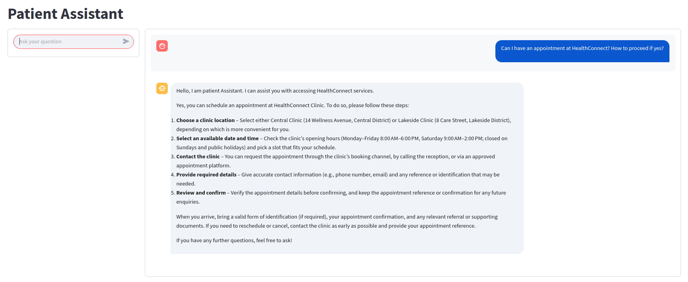

# HealthConnect AI Assistant 

## Overview

In week 7, I tested the robustness of the system prompt built in week 6 by running 
it on two different model backends, **Gemini** and **ChatGPT**, against an 
identical 9-prompt test set. The goal was to confirm if the prompt reliably guides 
assistant behavior regardless of which model runs it. In week 8, I improved the 
system prompt and built an app that connect user to the model. 
I then tested the assistance on normal and out of scope questions.
The patient assistance satisfies metrics such as: Correctness, groundedness, 
completeness, safety and escalation. 

## Author

Luc Agbognisso

Generative AI Intern, AnalystLab Africa

*#AnalystLabAfrica*

